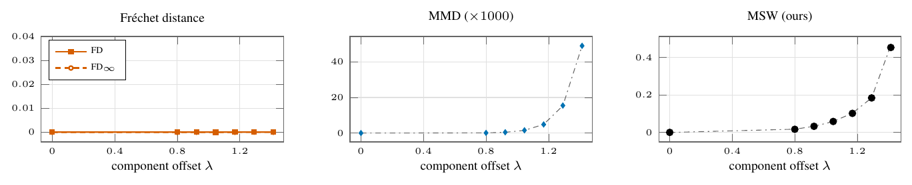

# 01 Moment-matched mixtures



A 2-D Gaussian against a mixture of four Gaussians with the same mean and covariance (CMMD paper, Table 2); n = 100,000 per side, 5 repeats. FD and FD∞ stay at zero; MMD and MSW increase strictly and match their exact values (dash-dot line). MSW here is its estimator on 16 fixed projection directions.

```
python run.py && python figure.py && pdflatex figure.tex
```
