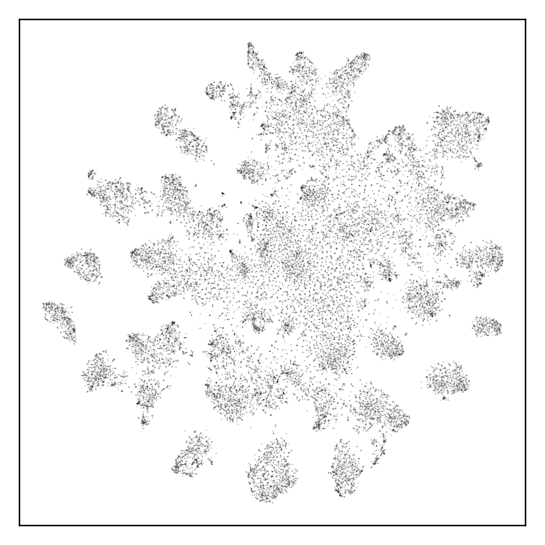

# 02 Normality of the embeddings



t-SNE of the Inception embeddings of COCO-30k (CMMD paper, Fig. 2 and Appendix A). Every test rejects normality: Mardia skewness z = 19,350, Mardia kurtosis z = 20,107 (paper: 19,023), Henze–Zirkler z = 1.8·10²³⁷; CLIP embeddings fail as well (`results/normality.json`).

```
python ../common/prep_coco.py && python ../common/measure.py coco512 && python run.py
```
