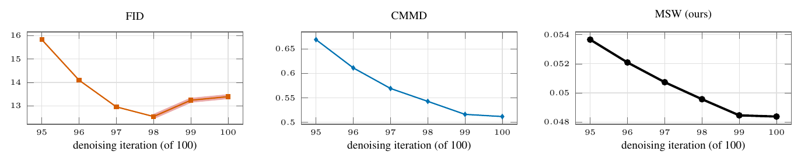

# 03 Late Stable Diffusion iterations



Stable Diffusion 1.4 on the COCO-30k captions after iterations 95–100 of 100, against COCO-30k, 30,000 images per set (CMMD paper, Fig. 6). FID rises over the last two iterations, by 24 and 37 paired-bootstrap standard deviations; CMMD and MSW decrease at every step. Red: a step in the wrong direction.

```
bash run.sh && python figure.py && pdflatex figure.tex
```
