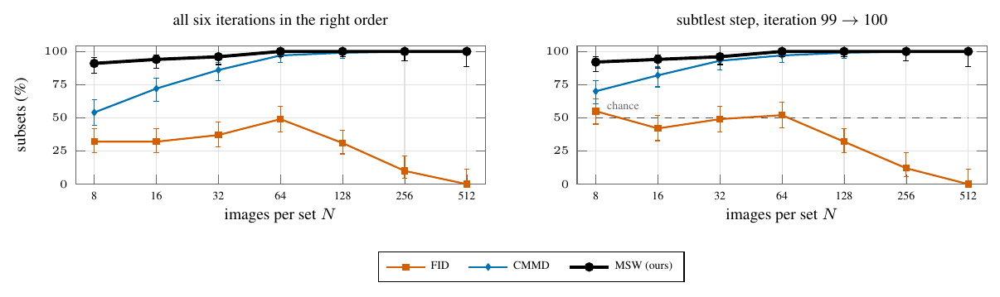

# 04 Late Stable Diffusion iterations from few images



The six iteration sets of 03 scored on random subsets of N captions, the same images for every metric. From 8 images, MSW orders all six correctly on 91% of 100 subsets, CMMD on 54%, FID on 32% (paired McNemar, MSW against CMMD: p = 6·10⁻⁸; significant up to N = 32). Bars: 95% Wilson intervals.

```
python run.py && python figure.py && pdflatex figure.tex      # after 03
```
