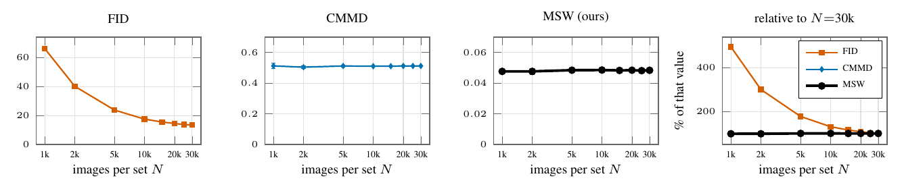

# 05 Number of images



Stable Diffusion 1.4 against COCO-30k on random subsets of N captions, 5 subsets per N (CMMD paper, Fig. 8). At 1,000 images FID reads 494% of its value at 30,000; CMMD and MSW stay within 1.5% at every N.

```
python run.py && python figure.py && pdflatex figure.tex      # after 03
```
