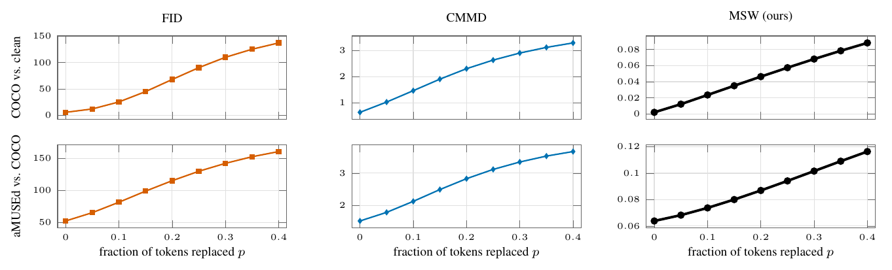

# 06 VQGAN latent noise, 16-pixel tokens



A fraction p of the tokens of a 16-pixel VQGAN (aMUSEd-256, 16×16 tokens at 256 px) replaced at random. Top: COCO-30k against clean COCO (CMMD paper, Fig. 1). Bottom: aMUSEd-256 images against COCO-30k (Fig. 7). All three metrics increase monotonically in both settings.

```
bash run.sh && python figure.py && pdflatex figure.tex
```
