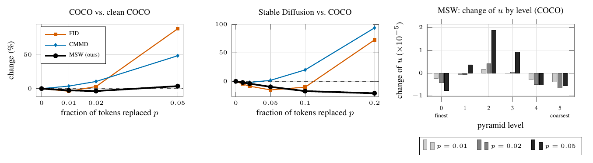

# 07 VQGAN latent noise, 8-pixel tokens



The same corruption with an 8-pixel VQGAN (VQ-Diffusion ITHQ, 64×64 tokens at 512 px), the granularity of Muse's 512-pixel stage. On COCO, FID falls at p = 0.01 (−4.0%) and MSW at p = 0.01 and 0.02 (−2.6%, −3.6%); CMMD rises. On Stable Diffusion images all three fall at first, CMMD briefly (−1.9%), FID down to p = 0.05 (−15%), MSW down to p = 0.2 (−21%). Right: MSW's dip comes from the finest and the two coarsest pyramid levels (2,000 images).

```
bash run.sh && python figure.py && pdflatex figure.tex      # after 03
```
