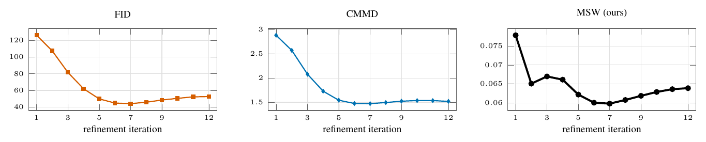

# 08 Refinement iterations of an open Muse



aMUSEd-256, the open reproduction of Muse, on the COCO-30k captions: the full-image prediction after each of its 12 iterations, against COCO-30k (CMMD paper, Figs. 3–4). All three metrics reach their minimum at iteration 7 and rise afterwards. Full (12 iterations) against early-stopped (10) as in Table 3: FID and MSW prefer the early-stopped set, CMMD the full one; the human ratings of Table 3 are not reproduced.

```
bash run.sh && python figure.py && pdflatex figure.tex
```
