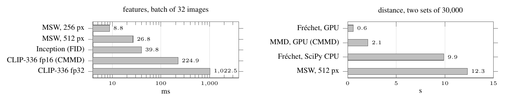

# 09 Runtime



One V100, medians of 5 runs (CMMD paper, Table 4). Left: features for a batch of 32 images. Right: the distance between two sets of 30,000. End to end on 30,000 against 30,000 images at 512 px, MSW takes 94 s (measured); extrapolating the per-batch times gives about 76 s for FID and 424 s for CMMD.

```
python run.py && python figure.py && pdflatex figure.tex      # after 03
```
