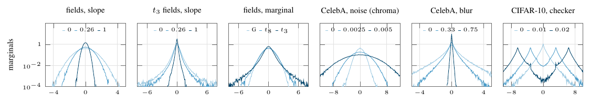

# Fig. 1 — What one slice sees



The pooled marginal of one high-frequency slice (5×5 DCT atom (4,4) at full resolution, every position of 500 images) under six perturbation families, three strengths each; the CelebA-noise panel uses the same atom on the R−G chroma axis. Histograms are normalised by the clean curve's standard deviation.

```
python run.py && pdflatex figure.tex
```
