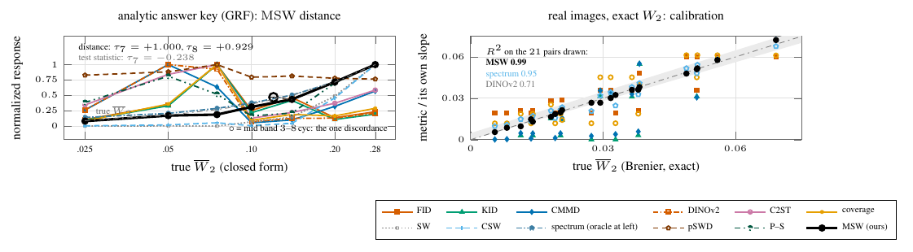

# Fig. 3 — Ordering and calibration against a known answer



**Left.** Eight perturbations of one Gaussian field, each calibrated to a known W₂ in closed form; N = 500, 48 repetitions. `msw.distance` orders the seven core points perfectly (Kendall τ₇ = +1.000; τ₈ = +0.929 with the mid-band point, one discordant pair; +0.942 ± 0.028 per repetition). The test statistic T, a detector, does not rank (τ₇ = −0.238), although it rejects every point in every repetition.

**Right.** CelebA under eleven gradient-of-convex models, so the exact W₂ between any two is known; 55 pairs, N = 800, 16 repetitions. On the 21 structured pairs (identity, contrast, blur) MSW is proportional to the true W₂ with R² = 0.994; the feature metrics reach 0.61–0.71.

```
python run.py key && python run.py calib && python figure.py && pdflatex figure.tex
```
