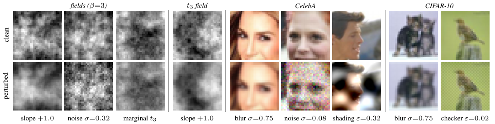

# Fig. S1 — The nine settings



One draw per column, clean (top) and perturbed (bottom), at display strengths chosen to be visible by eye and far above the detection thresholds of Table 1: fields slope +1.0, band noise 0.32, Gaussian → t₃ marginal, t₃ field slope +1.0; CelebA blur 0.75 and noise 0.08 on 32-px centre crops, shading 0.32 at 64 px; CIFAR-10 blur 0.75 and checkerboard 0.02. Each field column is one seeded draw shown with the same Fourier phases before and after; the CIFAR-10 blur column uses a detailed image (rank 220 of 300 by gradient energy), the checkerboard column a smooth one (rank 3). No statistic is computed.

```
python run.py && pdflatex figure.tex        # seconds, CPU
```
