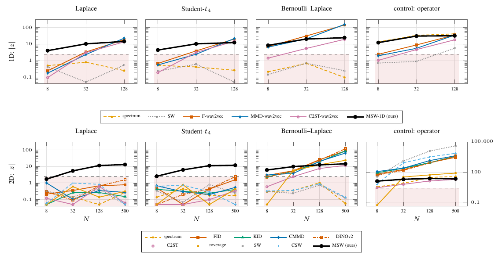

# Sparse stochastic processes



1D, near-integrator (Table S-ssp1d):

| | N | spectrum | SW | F-w2v | MMD-w2v | C2ST-w2v | MSW | MSW rej. |
|---|---|---|---|---|---|---|---|---|
| Laplace | 8 | -0.5 | +0.4 | +0.2 | +0.2 | -0.1 | **+4.0** | 50/50 |
|  | 32 | -0.8 | +0.1 | +3.3 | +2.3 | +3.0 | **+10.2** | 50/50 |
|  | 128 | -0.2 | +0.5 | +18.4 | **+22.6** | +13.5 | +14.4 | 49/49 |
| Student-t₄ | 8 | -0.5 | +0.2 | +0.7 | +0.5 | -0.2 | **+4.3** | 50/50 |
|  | 32 | -0.4 | -0.6 | +3.8 | +2.4 | +3.1 | **+10.2** | 50/50 |
|  | 128 | -0.3 | -0.0 | +20.1 | **+21.5** | +14.7 | +12.3 | 50/50 |
| Bern.–Lap. p = 0.05 | 8 | +0.2 | +0.1 | +6.9 | +6.5 | +1.4 | **+8.3** | 50/50 |
|  | 32 | +0.7 | -0.7 | **+30.8** | +20.4 | +5.4 | +20.1 | 50/50 |
|  | 128 | -0.1 | +0.2 | +141.3 | **+153.0** | +19.2 | +24.1 | 49/49 |
| Bern.–Lap. p = 0.005 | 8 | -0.4 | +1.0 | +5.1 | +4.0 | +1.5 | **+6.1** | 50/50 |
|  | 32 | +0.6 | +0.8 | **+22.6** | +12.9 | +5.2 | +13.4 | 50/50 |
|  | 128 | +0.3 | +2.7 | **+100.3** | +93.7 | +19.3 | +23.0 | 49/49 |
| operator control | 8 | **+13.5** | +0.7 | +2.4 | +1.9 | +1.0 | +12.1 | 50/50 |
|  | 32 | **+33.6** | +0.9 | +8.8 | +5.5 | +4.6 | +30.4 | 50/50 |
|  | 128 | **+41.1** | +5.6 | +35.2 | +34.7 | +18.1 | +31.5 | 50/50 |

Gaussian-innovation reference against matched-spectrum innovation laws (Laplace, Student-t₄, Bernoulli–Laplace) and an operator-change control, s = L⁻¹w under the near-integrator (a = 0.995), on 32 × 32 fields (2D, N = 8–500) and length-4096 signals (1D, N = 8–128). Deflection z = (mean alt − mean null)/sd null, 50 + 50 repetitions for MSW's `msw.test` T, 12 for the baselines; MSW rejections are the exact test at α = 0.05. In 2D MSW is the only method above the 2.49 band on Laplace and Student-t₄ (z = 5.4–13.0 from N = 32; best baseline DINOv2, 2.43 at N = 500) and rejects every repetition of every innovation cell from N = 32 (N = 8: Laplace 0.28, Student-t₄ 0.72); in 1D it rejects every repetition, but from N = 32 the wav2vec baselines have larger deflections on Bernoulli–Laplace and at N = 128 on Laplace and Student-t₄. Empirical size over the null cells 0–0.08.

msw has no 1D entry point, so the 1D column is the image test on the 64 × 64 raster of each sequence, not the bespoke 1D estimator of the original runs. Nine repetitions (Laplace and Bernoulli–Laplace draws at N = 128/500, sharing seeds) contained an infinite Laplace sample (`torch.rand` returned 0) and are dropped (49/49); `ssp.py` now clamps it. On 2D Bernoulli–Laplace p = 0.005 msw.test returns a valid p but T = NaN, so z is not reported for that row (rejections 1.0 at every N). `sspsmooth.csv` holds every operator (near, smooth, axis-zeroing) in 1D and 2D; under axis-zeroing in 2D MSW rejects every repetition from N = 32 on every contrast (N = 8: Laplace 0.20, Student-t₄ 0.72), while on Laplace at N = 500 CMMD (+30.9) and DINOv2 (+29.8) deflect further than MSW's T (+11.1).

`fig_ssp.png`, `fig_ssp1d.png`: realisations of the processes (`illustrate.py`).

```
python run.py && python figure.py && python table.py && python illustrate.py   # ~1.5 GPU-hours (run.py estimate; not logged)
pdflatex figure.tex && pdflatex fig_ssp.tex && pdflatex fig_ssp1d.tex           # baselines: results/baselines.json
```
