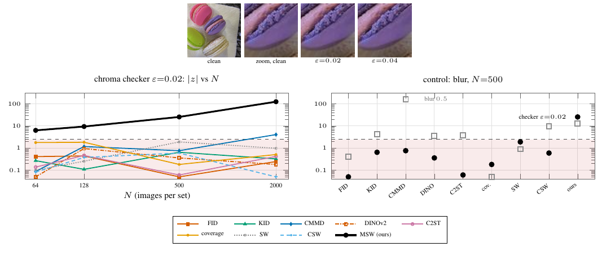

# Supp. Fig. (app:nullspace) — Resize blindness: the feature nullspace



A green–magenta Nyquist checker on the R−G opponent axis (ε = 0.02) is added to ImageNet-256 images; disjoint 2048-image halves, the same CPU-seeded draws for every method. Plotted is the deflection |z| = |E v_alt − E v_null| / sd(v_null) (floored at 0.05; shaded band below the certification threshold 2.4865); baselines from 10 null and 10 alternative repetitions (archived), MSW from 50 null and 30 alternative repetitions of `msw.test`. The checker keeps 0.34 (299 px bilinear, Inception) and 0.48 (224 px bicubic, CLIP/DINOv2) of its RMS through the extractors' input resizes. Seven of the eight baselines stay below threshold at every N; CMMD crosses only at N = 2000 (|z| = 4.1). MSW rejects every alternative draw at α = 0.05 at every N (|z| = 6.3, 9.4, 25.5, 125 at N = 64, 128, 500, 2000).

Right: the blur-0.5 px control at N = 500 through the same pipeline is detected by KID (4.2), CMMD (164), DINOv2 (3.6), C2ST (3.7) and CSW (9.5), not by FID (0.40), coverage or SW (0.90); MSW 12.7, power 1.00. Observed size of `msw.test` on the real-vs-real null at α = 0.05: 0.04, 0.00, 0.10, 0.00 at N = 64, 128, 500, 2000 (50 repetitions each; the two halves are not exactly exchangeable). Per-cell MSW numbers: `data/ours_detail.csv`.

```
python run.py && python figure.py && pdflatex figure.tex   # MSW cells, ~2 GPU-hours; baselines: results/baselines.json
python figure.py --tiles                                   # image tiles, needs imagenet256_ref.pt
```
