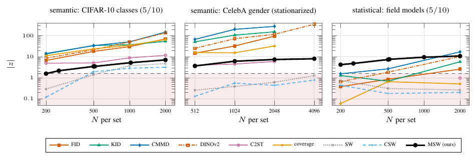

# Fig. S (fig:modedrop) — Mode dropping: semantic against statistical modes



Half of ten modes are dropped from the second set: CIFAR-10 classes (left), males from stationarized CelebA 64 px, each image circularly shifted at random (middle), and five of ten Gaussian field models of a mixture (right). Each curve is the deflection |z| = |mean_alt − mean_null| / sd_null; for MSW it is the deflection of the statistic T of `msw.test`, 200 null and 200 alternative repetitions per rung (gender: 120 at N = 2048, 60 at N = 4096). With N★ the first rung at which `msw.test` (α = 0.05) has power ≥ 0.8 and keeps it, MSW needs N★ = 1024 on CIFAR-10 classes (power 0.805 at 500, 0.795 at 512, 0.950 at 1024), 512 on stationarized gender (0.930) and 200 on the field mixture (0.825; 0.895 at 256), with measured size between 0.020 and 0.100 across all rungs (0.100 at CIFAR-10 N = 64, 20/200). On the semantic panels every feature metric is above 1.645 at the smallest size measured (CIFAR-10 N = 200: FID 6.7, KID 13.6, CMMD 14.3; gender N = 512: FID 14.8 to CMMD 66.9); on the field mixture at N = 2000 only CMMD (power 0.83) and DINOv2-FD (1.00) reach power 0.8, FID and KID reach 0.75, and C2ST, coverage, SW and CSW stay below |z| = 1.645.

Baseline curves are archived (results/baselines.json, 12–15 repetitions per cell); the field-mixture baselines at N = 200 and 500, except DINOv2, are taken from the paper's CSV because their run was lost. MSW and the baselines are therefore compared on different read-outs: exact power for MSW, |z| for the baselines.

```
python run.py && python figure.py && pdflatex figure.tex   # MSW column, ~3 GPU-hours (estimate in run.py; H200, no timing recorded); baselines: results/baselines.json
```
