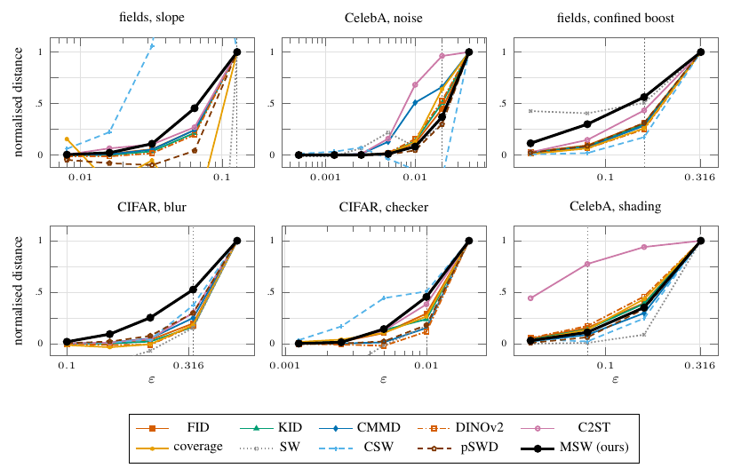

# Does the distance grow with the perturbation?




`msw.distance` and nine baselines on six perturbation ladders under the paired design (within a repetition the reference set and the clean part of the candidate set are fixed, seed 1000r+7; only ε moves), N = 500, 12 repetitions (fields slope, CelebA noise, confined boost) or 15 (CIFAR blur, CIFAR checker, CelebA shading); each run is normalised as (v(ε) − v(0)) / (v(ε_max) − v(0)) and counted monotone when no step falls back by more than 1% of its rise. MSW is monotone in 80/81 runs (mean Kendall τ = 0.978; the one failure is a CIFAR-blur run), FID 80/81 (0.968), CMMD 79/81 (0.973), KID 79/81 (0.944), pSWD 76/81 (0.888), SW 32/81 (0.466), CSW 32/81 (0.621). The dotted rule (smallest rung where most runs' 95% interval clears zero) falls at ε = 0.128, 0.02, 0.16, 0.33, 0.01, 0.08. On single CelebA-noise runs (S6, 12 reps) MSW is monotone in 12/12, 12/12, 11/12 runs at N = 1000, 200, 25; SW at most 1/12 and CSW at most 2/12. Baselines are the archived paired measurements (`results/baselines.json`); all numbers are in `data/summary.json`.

```
python run.py && python figure.py && pdflatex figure.tex   # MSW columns, ~5 GPU-minutes
pdftoppm -png -r 160 -f 1 -l 1 -singlefile figure.pdf figure
pdftoppm -png -r 160 -f 2 -l 2 -singlefile figure.pdf figure_singlerun
```
