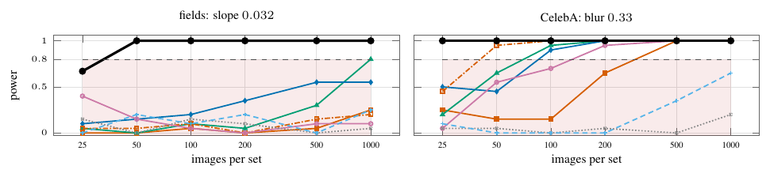

# Fig. S (app:power) — Power against sample count



Power at a fixed perturbation (fields slope 0.032, CelebA 32-px blur 0.33) for N ∈ {25, 50, 100, 200, 500, 1000} images per set. MSW is `msw.test` rejecting at p ≤ 0.05, 100 alternative repetitions per rung, no simulated null; the baseline curves are the archived exp26 powers (20 repetitions, threshold = null mean + 1.645 sd over 20 null repetitions). MSW reaches power 1.00 at N = 25 on CelebA blur and 0.67 (95% Wilson [0.57, 0.75]) at N = 25 on fields, 1.00 from N = 50; the best baselines reach 0.8 at N = 50 (CelebA, DINOv2) and N = 1000 (fields, KID). The empirical size of the MSW test over 50 null repetitions per rung is 0.00–0.10 (`ours_size` in `data/`).

```
python run.py && python figure.py && pdflatex figure.tex   # MSW curve, ~20 GPU-minutes; baselines: results/baselines.json
```
