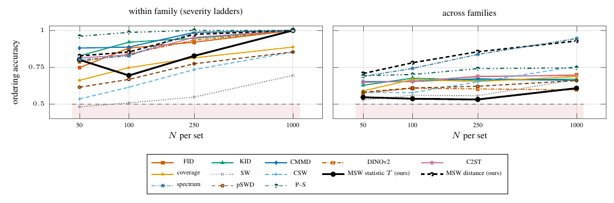

# Ranking ten models with a known key



Ten stationary Gaussian field models (two severities in each of five spectral families) with exact W2 to the reference; each metric scores the fraction of model pairs it orders like the key (tie = 0.5), mean over 15 repetitions, within family (5 pairs) and across families (40 pairs). Across families the MSW distance scores 0.707/0.780/0.855/0.928 at N = 50/100/250/1000 and the statistic T 0.545/0.535/0.530/0.607; the spectrum distance scores 0.687/0.742/0.837/0.945, P–S 0.692–0.745, and the feature metrics at most 0.755 (CSW, N = 1000). Within families the distance scores 0.827/0.853/0.973/1.000, below P–S (0.960/0.987/1.000/1.000) up to N = 250. The exact test rejects 90/92/97/100% of the ten models at the four N. The feature-metric columns are archived (exp35); MSW, spectrum, pSWD and P–S were rerun on the same draws.

```
python run.py && python run.py --classical && python figure.py && pdflatex figure.tex   # ~20 + ~15 GPU-minutes
```
