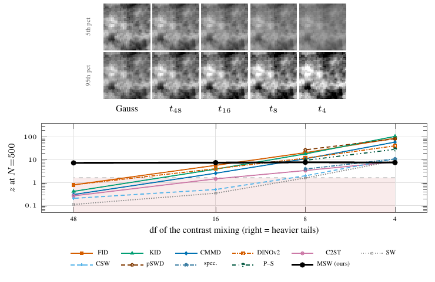

# Fig. S (fig:camouflage) — Moment-matched contrast mixtures



Gaussian fields (32 px, |k|⁻³ spectrum, N = 500 per set) whose second set is multiplied per image by an independent contrast ν with ν² = (df − 2)/χ²_df, so the mean, covariance and all third-order pixel moments match exactly; top: one field at the 5th/95th contrast percentile, bottom: deflection z = (mean T_alt − mean T_null)/sd T_null. MSW uses 50 null repetitions (seeds 70000 + r) and 50 alternative repetitions per df (seeds 1000r + 7); baselines are the archived 25/25-repetition measurements. MSW is flat at z = 7.4–7.8 on the panel df = 4–48 with power 1.000 (50/50, Wilson [0.929, 1]); spectrum, Portilla–Simoncelli and patch SWD read 4.0/11.0, 9.6/28.9 and 27.5/83.3 at df = 8/4.

| df | 4 | 48 | 96 | 192 | 384 | 768 | 1536 | 3072 |
|---|---|---|---|---|---|---|---|---|
| z | 7.67 | 7.39 | 6.19 | 2.76 | 0.85 | 0.19 | 0.06 | 0.06 |
| power | 1.000 | 1.000 | 1.000 | 0.820 | 0.240 | 0.100 | 0.120 | 0.060 |
| erased | 0% | 4% | 19% | 64% | 89% | 98% | 99% | 99% |

The power-0.8 frontier lies between df = 192 and 384 (log-linear ≈ 197); from df = 768 on, power is at the null rejection rate, which is 0.100 (5/50, Wilson [0.043, 0.214]) on this setting. Erasure is the loss of the statistic's excess over the null mean relative to df = 4.

```
python run.py                          # panel + frontier ladder, ~30 GPU-minutes
python figure.py && pdflatex figure.tex && pdftoppm -png -r 160 -singlefile figure.pdf figure
```
