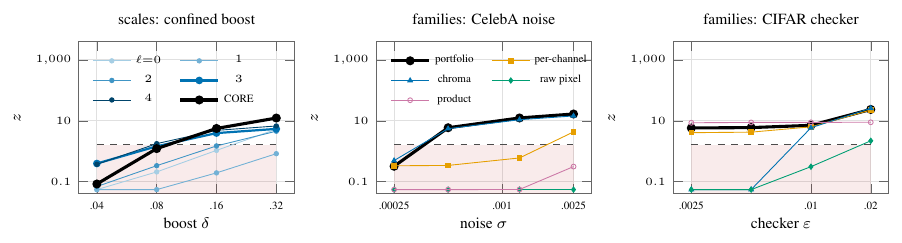

# Ablations




Table S-banks, ε₀.₈ when only the 5 × 5 spatial atoms change (all larger rungs also at power ≥ 0.8):

| | DCT | random | orthonormal | patch PCA |
|---|---|---|---|---|
| Fields, slope | **0.008** | 0.016 | 0.016 | **0.008** |
| CelebA, added noise | **0.0005** | 0.005 | 0.005 | **0.0005** |
| CelebA, blur | **0.1** | 0.22 | 0.22 | **0.1** |
| CelebA, shading | 0.02 | 0.02 | 0.02 | 0.02 |
| CIFAR-10, checkerboard | 0.000625 | 0.000625 | 0.000625 | 0.000625 |
| the same, product slices removed | **0.00125** | 0.02 | 0.02 | **0.00125** |

Component deletion, ε₀.₈ (first rung with power ≥ 0.8) of CORE, of the transport rows alone, and of CORE minus one group:

| | CORE | T only | CORE−T | CORE−TL | CORE−PX | CORE−J |
|---|---|---|---|---|---|---|
| Fields, slope | 0.008 | 0.008 | 0.064 | 0.008 | 0.008 | 0.008 |
| Fields, noise | 0.04 | 0.02 | 0.08 | 0.04 | 0.04 | 0.04 |
| Fields, marginal (1/df) | 1/96 | 1/48 | 1/192 | 1/48 | 1/192 | 1/192 |
| t3 fields, slope | 0.064 | 0.064 | 0.064 | 0.064 | 0.064 | 0.064 |
| CelebA, blur | 0.1 | 0.1 | 0.15 | 0.1 | 0.1 | 0.1 |
| CelebA, added noise | 0.0005 | 0.0005 | 0.00125 | 0.0005 | 0.0005 | 0.0005 |
| CelebA, shading | 0.02 | 0.08 | 0.02 | 0.02 | 0.08 | 0.02 |
| CIFAR-10, blur | 0.15 | 0.15 | 0.22 | 0.15 | 0.15 | 0.15 |
| CIFAR-10, checkerboard | 0.000625 | 0.01 | 0.000625 | 0.000625 | 0.000625 | 0.00125 |

Every series is MSW, as a column subset, pyramid truncation or bank swap of the orbit table `msw.test` builds. Levels/depth: 128-px fields, amplitude boost confined to [1, 3)/128 cyc/px, N = 200, 50 null and 50 alternative repetitions; at δ = 0.32 the per-level transport z reads 10.8 (ℓ = 3), 10.0 (ℓ = 4) and 2.3 (ℓ = 0), and the scale-aware aggregate detects from δ = 0.08 (z = 2.1, power 0.74) against δ = 0.32 for one scale (power 0.96). Families: N = 500, 50 null and 30 alternative repetitions; on CelebA noise only the chroma family detects (z = 14.4 vs 4.3 per-channel at σ = 0.0025), on the checkerboard the product slices lead (z = 8.6 vs 4.1 at ε = 0.0025, both power 1.00). Banks: 24 alternative repetitions per rung; deletion: 48 per rung on the Table 1 grids, with the same draws as `main/02` except fields marginal and t3, whose chi-square mixing variable comes from torch's global generator — on fields marginal CORE has power 0.79 at 1/192 here against 0.83 in `main/02` (1/192), so its ε₀.₈ reads 1/96.

The per-level series of the two figures differ by definition: Fig. S-ablation (left) is the exact max-z test of each level's transport and tail/shape columns, Fig. S-depth (left) the per-level transport z of the DCT family (`TestResult.per_level`).

```
python run.py levels && python run.py families     # ~30 GPU-minutes (run.py estimate; not logged)
python run.py banks && python run.py loo           # ~2 GPU-hours (run.py estimate; not logged)
python figure.py && python table.py && pdflatex figure.tex && pdflatex figure_depth.tex
```
