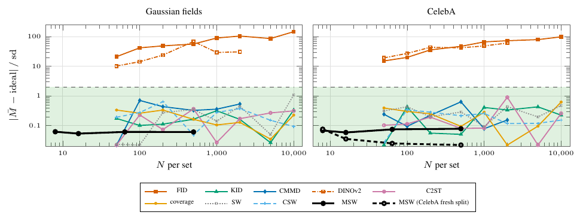

# Zero floor on null draws



Offset of each metric's null reading from its ideal value, |mean − ideal| / sd, when both sets come from the same distribution (green band: < 2 sd; values below 0.022 drawn at the floor). MSW: the U-statistic u = sign(d)·d² behind `msw.distance`, 300 null repetitions per N ∈ {8, 16, 64, 500} (seeds 70000 + r) on Gaussian fields, fixed disjoint CelebA halves and a fresh random CelebA half-split per repetition; baselines: archived exp22, 15 repetitions per N ∈ {50, …, 10000}. MSW sits at 0.05–0.08 sd on every family and N (test of zero mean: |z| = |mean|/mcse ≤ 1.35); the 95% jackknife interval covers 0 in 97.7–99.3% of repetitions. FID and DINOv2-FD sit 10–147 sd from ideal; the other baselines stay below 1.1 sd.

| family | N=8 | 16 | 64 | 500 |
|---|---|---|---|---|
| fields: off (sd) / z | 0.062 / −1.07 | 0.053 / 0.93 | 0.061 / 1.06 | 0.061 / 1.05 |
| CelebA fixed halves | 0.068 / 1.17 | 0.058 / 1.01 | 0.074 / 1.29 | 0.078 / 1.35 |
| CelebA fresh split | 0.075 / 1.31 | 0.035 / 0.61 | 0.025 / 0.43 | <0.022 / −0.02 |

The paper's original MSW curve plotted z (mean over its Monte-Carlo error) at N = 64, 500 only; this figure plots the sd-unit offset, the same quantity as the baseline curves, at all four N.

```
python run.py                        # MSW series, ~15 GPU-minutes
python figure.py && pdflatex figure.tex && pdftoppm -png -r 160 -singlefile figure.pdf figure
```
