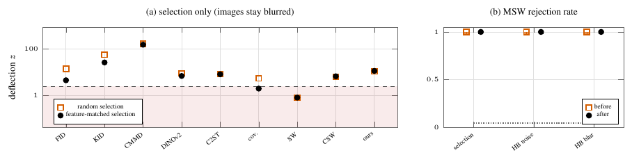

# Gaming the metrics



Blurred CIFAR-10 images (σ = 0.5 px) against clean ones, N = 512. **(a)** Choosing *which* blurred images to show — matching the reference's Inception k-means histogram (k = 32), no pixel changed — erases 68% of FID's excess signal, 54% of KID's and 64% of coverage's, and −4.9% of MSW's. **(b)** `msw.test` rejects in all 200 repetitions before and after every attack: the feature-matched selection, and a Heeger–Bergen projection onto MSW's own filter bank (60 iterations), started from noise or from the blurred pool. The projection erases 69% (from noise) and 14% (from blur) of the statistic's excess without stopping rejection, because the opponent-chroma tail/shape rows and the per-image pixel maximum are not functionals of the pooled marginals. Measured null size 0.045 over 200 repetitions. Baselines: the original runs (10 repetitions), deflection z against their own null.

```
python run.py select && python run.py hb noise && python run.py hb blur && python run.py score   # ~1 GPU-hour
python figure.py && pdflatex figure.tex
```
