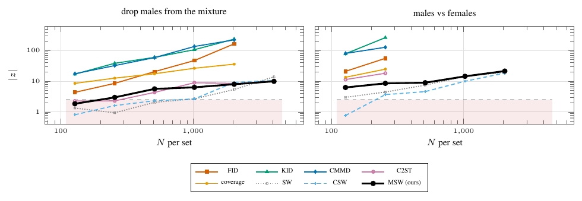

# CelebA gender, aligned



Aligned 64-px CelebA, reference pool = first 8000 images, comparison pool = the other 8000 (4631 female, 3369 male). Left: natural mixture against females only; right: males against females. Curves are |z| = |mean_alt − mean_null| / sd_null (MSW on the statistic T of `msw.test`, which is bounded, so only threshold crossings compare); dashed: |z| = 2.4865. MSW: `msw.test` at α = 0.05, 50 null and 30 alternative repetitions per rung; baselines: archived exp51, 12–15 repetitions, thresholded at their own null's 95th percentile.

N★ at power 0.8 (`data/nstar.csv`). Drop: MSW 256 (power 0.47 / 0.83 / 1.00 at N = 128 / 256 / 512, 1.00 from 512 on), FID, KID, CMMD and coverage 128, C2ST 512, CSW 512 (1024 by the |z| ≥ 2.4865 rule), SW 1024. Male/female: every method 128 (MSW power 1.00 at every rung) except CSW, 256. Measured MSW size on the nulls: 0.00–0.08.

The male/female contrast stops at N = 2048: at 4096 the null would put the whole male pool on both sides, so that rung is dropped for every method.

```
python run.py                        # MSW column, ~3 GPU-hours; baselines: results/baselines.json
python figure.py && pdflatex figure.tex && pdftoppm -png -r 160 -singlefile figure.pdf figure
```
