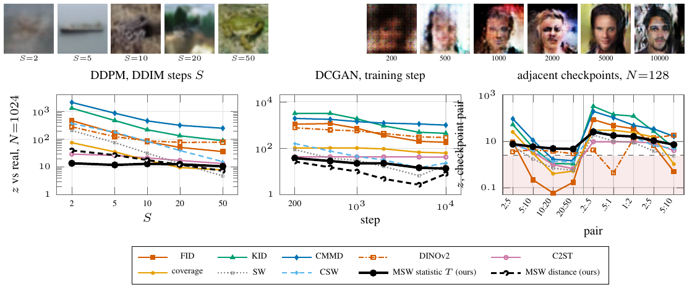

# Real generators



DDPM on CIFAR-10 sampled with S ∈ {2, 5, 10, 20, 50} DDIM steps, and DCGAN on CelebA-64 checkpointed at 200–10000 steps, each against held-out real images; every series is a deflection z against the real-vs-real null at the same N (N = 1024 for the ladders, N = 128 for the nine adjacent-checkpoint pairs; dashed line z = 2.4865). MSW: the statistic T of `msw.test` (50 repetitions per cell) and `msw.distance` (20 repetitions, ladder panels only); baselines: archived exp57, 10 repetitions, on the same image sets.

`msw.test` at α = 0.05 rejects every ladder rung against real data and every adjacent pair in 50/50 repetitions, including DDPM 20:50 (T deflection 4.6; FID 0.17) and DCGAN 5000:10000 (7.1; FID 0.49). Against the known order, Kendall τ of `msw.distance` is −1.00 on DDPM (39.4 / 26.6 / 17.7 / 12.1 / 7.2) and −0.73 on DCGAN (26.6 / 15.0 / 9.9 / 4.8 / 2.7 / 7.9, the 10000-step checkpoint out of order, as for SW and CSW); the deflection of T, bounded and flat at 10–37, gives −0.60 and −0.87 (`data/kendall_tau.json`).

```
python run.py                        # MSW columns, ~40 GPU-minutes; baselines: results/baselines.json
python figure.py && pdflatex figure.tex && pdftoppm -png -r 160 -singlefile figure.pdf figure
```
