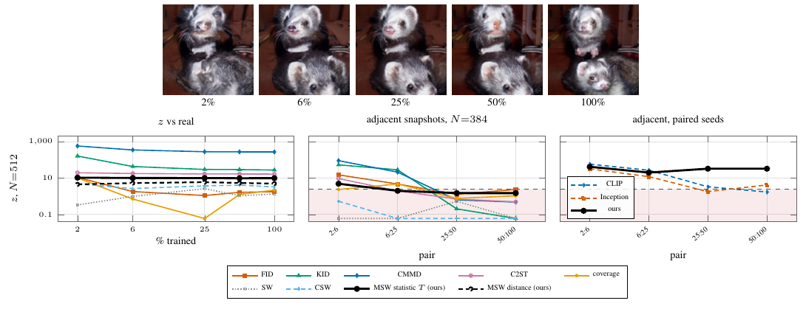

# EDM2 training snapshots



| transition | 2% → 6% | 6% → 25% | 25% → 50% | 50% → 100% | rolled control |
|---|---|---|---|---|---|
| MSW slices (paired) | +41.3 | +19.9 | **+32.4** | **+32.4** | −3.4 |
| CLIP (paired) | **+57.6** | **+26.7** | +3.3 | +1.7 | −3.5 |
| Inception (paired) | +31.9 | +11.9 | +1.8 | +4.2 | −2.6 |

EDM2-XS snapshots at 2–100% of training (1024 images each, shared seeds, frozen SD-VAE decoder) against ImageNet-256 val. Left: snapshot against real at N = 512 (50 null / 30 rung repetitions); middle: adjacent snapshots at N = 384 against the earlier snapshot's self-null; right and table: paired-seed differential z (max paired t over per-image features, 500 sign flips) on the 1024 matched images. Dashed line z = 2.4865. Baselines are the archived exp59/exp60 runs.

`msw.test` rejects every rung in 30/30 repetitions (p ≤ 0.0005) with T deflection flat at 9.7–10.5, and `msw.distance` is flat as well (4.5 / 5.3 / 5.9 / 5.3 / 4.9). Unpaired adjacent snapshots reject in 97%, 10%, 7% and 7% of repetitions (null size 0.00–0.04). Paired, the MSW per-image family is above threshold on all four transitions with sign-flip p = 0.002 (the smallest attainable with 500 flips), and 32.4 on both late transitions against 3.3 / 1.7 (CLIP) and 1.8 / 4.2 (Inception); the roll-by-one control gives −3.4 (p = 1).

```
python run.py unpaired && python run.py paired     # ~3 GPU-hours + ~15 GPU-minutes; baselines: results/baselines.json
python figure.py && python table.py && pdflatex figure.tex && pdftoppm -png -r 160 -singlefile figure.pdf figure
```
