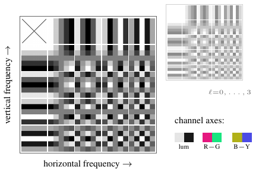

# Fig. "Filter atlas" — the 5×5 DCT atoms and the colour axes



The 25 atoms of `msw.dct_bank(5)` (DC drawn crossed out; the bank drops it), mid-grey = 0, each atom scaled to its own max |w|, and the three channel axes of `msw.opponent_dct_bank` read back from the bank: luminance (1, 1, 1), R−G (1, −1, 0), B−Y (0.5, 0.5, −1) after scaling to max 1. The ghost copy stands for the same bank at the coarser pyramid levels (ℓ = 0…3 at 64 px; 32-px data stop at ℓ = 2 because the pyramid halts below 10 px). The per-channel family applies the same atoms to R, G and B separately; the opponent family's signed components use its chroma atoms only.

```
python figure.py && pdflatex figure.tex      # CPU, seconds
```
